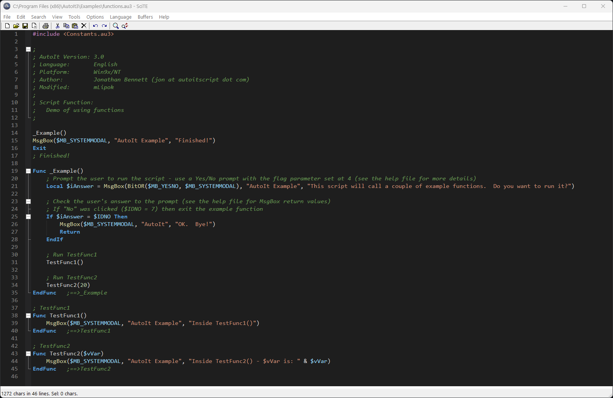

# SciTE4AutoIt3 Dark Theme

A high-contrast, VS Code–inspired dark theme for **SciTE4AutoIt3** on Windows.

## Features

- Dark editor background and readable syntax colors for AutoIt code
- Distinct colors for comments, functions, variables, keywords, macros, and strings
- Dark line-number margin, fold margin, selection, and output pane
- AutoIt syntax highlighting for newly created, unsaved files

## Installation

1. Open SciTE4AutoIt3.
2. Go to **Options → Open User Options File**.
3. Back up your existing `SciTEUser.properties`.
4. Copy the contents of this repository's [SciTEUser.properties](SciTEUser.properties) into your user options file (replacing the previous theme settings).
5. Save the file and restart SciTE.

The theme was tested interactively in SciTE4AutoIt3. Your results may vary if other user, global, or SciTEConfig settings override the style properties.

## Screenshot

## License

MIT — see [LICENSE](LICENSE).

This is an independent community theme, not an official Microsoft or AutoIt release.
